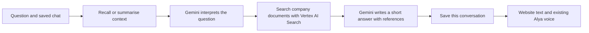

# Alya's chat brain

## What changed

Gemini interprets questions and writes answers. Vertex AI Search finds the company passages. LangChain connects the model, and LangGraph runs the conversation workflow and saves its state with a SQLite checkpointer. These libraries organise the model; they are not language models or a company-trained AI.



For example, ask “What should I wear?” and then “What if I wear a tshirt?” Alya receives the earlier exchange, rewrites the follow-up into a dress-code search and uses the retrieved guidance. The answer must retain any weekday/Friday exceptions found in the source. No company policy is hardcoded into this example.

## Use it

Open `/mira`. Send a question normally. **Saved chats** reopens earlier conversations; refresh or leave and return to continue the selected chat. **New chat** starts separate context. **Delete current chat** removes its visible history and LangGraph checkpoints after the on-screen confirmation.

Memory is tied to an opaque HttpOnly browser cookie, not the website's editable profile name. A different browser/device has separate history. New chats do not automatically reuse personal facts from other chats; reopen the original conversation to continue it. Clearing browser cookies loses access to that browser's history. There is no employee account synchronisation yet.

Chats expire after 30 days without a successful answer. Expired records are removed when chat history is next accessed. There are at most 30 saved chats per browser session and 80 questions per chat. Older conversation context is summarised to limit prompt size; summaries can lose detail. Full successful exchanges remain available to read until expiry or deletion. Failed requests are shown in the interface but are not added to saved visible history. Reopening history does not replay its voice.

## Configure Gemini

Use `AI_MODE=gemini-chat` in the server `.env` for the connected company assistant. The existing local `.env` is preserved. The shareable `.env.example` has blank credentials and starts with sample answers. Keep the key server-side, without a `VITE_` prefix.

Gemini runs on Vertex AI using Application Default Credentials (the api service account on Cloud Run, or `gcloud auth application-default login` locally). It needs `GOOGLE_CLOUD_PROJECT`; `GOOGLE_CLOUD_LOCATION` defaults to `global`. Without a project, `gemini` mode serves sample answers and `gemini-chat` returns `GEMINI_NOT_CONFIGURED`. An HTTP 402 means billing on the Google Cloud project must be restored; 401/403 means the service account lacks the Vertex AI User role.

Then run this from the project folder:

```powershell
node scripts/check-gemini-connection.mjs
```

This makes one small structured-output Gemini request. It reports model/access status without printing the key. If it succeeds, ask a question on the website. Normal short questions use one interpretation request and one answer request; long conversations occasionally need a summary request. Automatic provider retries are disabled. Retrying an already completed request with the same request ID returns its saved answer without another model call.

`AI_MODE=document-search` is a search-only preview. It quotes the top two passages from the same company search and calls no Gemini model. It has no conversation memory. Each question is still a billed Vertex AI Search query.

## Company documents: Vertex AI Search

Company passages come from Vertex AI Search (Discovery Engine). The team uploads files to the documents bucket and imports them into the `onboardai-docs` data store. Import is a manual or REST step, not part of the deploy. The data store uses the layout parser and layout-based chunks of 500 tokens, with ancestor headings included. The API only queries the search engine; it has no access to the bucket.

| Setting                   | Meaning                                                                                               |
| ------------------------- | ----------------------------------------------------------------------------------------------------- |
| `VERTEX_SEARCH_ENGINE_ID` | Search engine to query (`onboardai-search` in the cloud). Blank: the sample guide is used, see below. |
| `VERTEX_SEARCH_LOCATION`  | Engine location, default `global`. `us` and `eu` use their regional endpoints.                        |
| `GOOGLE_CLOUD_PROJECT`    | Project ID or number, shared with Gemini.                                                             |

Each company question makes one search request. It is sent with a Bearer token from Application Default Credentials, with a 15-second limit and no automatic retries:

```text
POST https://discoveryengine.googleapis.com/v1/projects/{GOOGLE_CLOUD_PROJECT}/locations/{VERTEX_SEARCH_LOCATION}
     /collections/default_collection/engines/{VERTEX_SEARCH_ENGINE_ID}/servingConfigs/default_search:search
{ "query": "<Gemini's standalone rewrite>", "pageSize": 5,
  "contentSearchSpec": { "searchResultMode": "CHUNKS",
                         "chunkSpec": { "numPreviousChunks": 1, "numNextChunks": 1 } } }
```

Each result's matching chunk and its neighbouring chunks become one numbered passage. A chunk already used in a higher-ranked passage is not repeated. Passage IDs follow the search rank. Gemini must cite them, and company answers without a valid citation are withheld. When the search returns nothing, Alya asks for more detail or suggests HR, with no Gemini answer request. Reference validation checks passage IDs. It does not prove that every generated sentence follows from the text, and semantic search can still miss a passage. Review answers against current company policy before rollout.

References show the **file name** and, when available, the section heading and page, for example `Employee Handbook.pdf` with `Dress Code · page 4`. The file name is the last part of the document's Cloud Storage path, or else its title. `gs://` URIs and bucket names are never shown, and there are no download links.

Search failures reach the browser only as fixed messages. Google error bodies, tokens and queries are not forwarded. The server log records the code, HTTP status and Google's reason, such as `PERMISSION_DENIED`.

| Code                      | HTTP | Cause                                                                    |
| ------------------------- | ---- | ------------------------------------------------------------------------ |
| `SEARCH_NOT_CONFIGURED`   | 503  | Engine ID set without `GOOGLE_CLOUD_PROJECT`, or an invalid location     |
| `SEARCH_AUTH_REQUIRED`    | 503  | No credentials, or Google answered 401                                   |
| `SEARCH_ACCESS_DENIED`    | 503  | 403: the service account needs `roles/discoveryengine.viewer`            |
| `SEARCH_NOT_FOUND`        | 503  | 404: wrong engine ID or location                                         |
| `SEARCH_REQUEST_REJECTED` | 503  | 400 or 412: the engine or data store settings do not support the request |
| `SEARCH_RATE_LIMIT`       | 429  | 429: search quota reached                                                |
| `SEARCH_TIMEOUT`          | 504  | No answer within 15 seconds                                              |
| `SEARCH_UNAVAILABLE`      | 503  | 5xx, network failure or an unreadable response                           |

**Without `VERTEX_SEARCH_ENGINE_ID`** (the local default), `gemini-chat` and `document-search` use the built-in sample onboarding guide instead and make no search request. Its passages are labelled "Sample onboarding guide (confirm with HR)" and say they are unapproved. The server prints the knowledge source at start-up. `AI_MODE=gemini` (single-turn) and `demo` always use the sample tasks.

To search the real engine locally, set the three settings and sign in with Application Default Credentials. Signing in as the API service account also tests its real permissions: `gcloud auth application-default login --impersonate-service-account=<api service account email>`. If a search with your own user account fails with a quota-project message, use impersonation. `npm run check:search -- "What are the working hours?"` runs one search. It prints file names, sections and character counts, never passage text or tokens.

## Information boundaries

Only documents approved for the intended employees belong in the data store. Prompt instructions cannot reliably hide PNC information that the model has already received. Exclude restricted HR records, passwords, individual salary/medical details and other material employees should not access. For multiple employee roles, add real employee sign-in and apply document permissions **before retrieval**. The browser-session isolation added here is not employee authentication. Keep this preview local until that is implemented.

Vertex AI Search receives Gemini's rewritten query. Gemini receives the recent conversation, any earlier summary and the selected reference passages to generate answers. Neither receives browser-supplied document IDs or filters. The website does not enable LangSmith tracing. Saved messages and graph state are stored unencrypted in ignored `.cache/chat/conversations.sqlite`; protect this folder, backups and server account access. `CHAT_DATABASE_PATH` can point to a persistent private database location. Public hosting must preserve that storage across restarts; for multiple server instances, replace SQLite and the in-process turn lock with shared database/locking infrastructure.

The dependency audit currently reports seven advisory entries in the existing Kokoro/Transformers voice dependency tree, with no automatic fix available. The new LangChain/Graph packages were not listed. Review that voice dependency tree before public deployment; this chat task does not change the voice engine.

## Files

| File                                    | Purpose                                                                          |
| --------------------------------------- | -------------------------------------------------------------------------------- |
| `server/gemini-chat-workflow.mjs`       | Gemini models, LangGraph workflow, summaries, references and safe errors         |
| `server/vertex-ai-search.mjs`           | Vertex AI Search request, chunk-to-passage mapping, file names and safe errors   |
| `server/company-document-retriever.mjs` | Chooses Vertex AI Search or the sample guide                                     |
| `server/document-search.mjs`            | Search-only preview mode that quotes passages without Gemini                     |
| `server/saved-conversations.mjs`        | SQLite history, ownership checks, retention and deletion                         |
| `server/api-routes.mjs`                 | Saved-chat endpoints and browser-session cookie                                  |
| `src/avatar/AlyaChatPage.jsx`           | Reopen/new/delete chats, text answers, references and existing voice integration |
| `tests/gemini-chat-workflow.test.mjs`   | Context, restart persistence, isolation, retry, source and error tests           |
| `tests/document-search.test.mjs`        | Search request shape, passages, file names, errors, timeout and sample fallback  |

Implementation follows the current official [ChatGoogle integration](https://docs.langchain.com/oss/javascript/integrations/chat/google), [LangGraph memory guide](https://docs.langchain.com/oss/javascript/langgraph/add-memory) and [SQLite checkpointer](https://github.com/langchain-ai/langgraphjs/tree/main/libs/checkpoint-sqlite). It uses the recommended `@langchain/google` package rather than the older Google GenAI integration.

## Response speed

The normal company-answer path makes two sequential Gemini requests: interpret the question, then write a source-supported answer. Long chats occasionally add a summary request. Voice is requested separately after the written answer and does not delay it.

Company retrieval is one Vertex AI Search request between the two Gemini requests. There is no document cache or start-up warmup to prepare.

The server prints `Alya reply timing (milliseconds)` after a successful new answer. `summary`, `interpretation`, `retrieval`, `answer` and `total` identify where time is spent, without printing the question, documents or credentials. The response also contains `timingsMs` for development inspection. Provider latency still varies; these changes do not guarantee instant replies.

Response times with Vertex AI Search have not been measured yet. The earlier measurements were taken with the retired Google Drive retrieval and no longer apply.

## Verification

Run `npm test` and `npm run build` to check the project. Conversation and search tests use synthetic documents, a fake search endpoint and injected model responses. They verify routing, request shape and persistence, not every real Gemini answer or search ranking. Regression tests confirm old lesson state cannot restrict new questions, and chat history is preserved. See [Answer styles](answer-styles.md) for the current presentation controls and limits.

Visual answers and support summaries: see [Visual guides and HR summary](visual-guides-and-hr-summary.md). The separate visual panel reuses delivered answer text. Support statistics update without an additional Gemini request and remain scoped to the current browser session.
