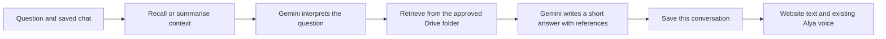

# Alya's chat brain

## What changed

Gemini interprets questions and writes answers. LangChain connects the model and retrieves company passages. LangGraph runs the conversation workflow and saves its state with a SQLite checkpointer. These libraries organise the model; they are not language models or a company-trained AI.



For example, ask “What should I wear?” and then “What if I wear a tshirt?” Alya receives the earlier exchange, rewrites the follow-up into a dress-code search and uses the retrieved guidance. The answer must retain any weekday/Friday exceptions found in the source. No company policy is hardcoded into this example.

## Use it

Open `/mira`. Send a question normally. **Saved chats** reopens earlier conversations; refresh or leave and return to continue the selected chat. **New chat** starts separate context. **Delete current chat** removes its visible history and LangGraph checkpoints after the on-screen confirmation.

Memory is tied to an opaque HttpOnly browser cookie, not the website's editable profile name. A different browser/device has separate history. New chats do not automatically reuse personal facts from other chats; reopen the original conversation to continue it. Clearing browser cookies loses access to that browser's history. There is no employee account synchronisation yet.

Chats expire after 30 days without a successful answer. Expired records are removed when chat history is next accessed. There are at most 30 saved chats per browser session and 80 questions per chat. Older conversation context is summarised to limit prompt size; summaries can lose detail. Full successful exchanges remain available to read until expiry or deletion. Failed requests are shown in the interface but are not added to saved visible history. Reopening history does not replay its voice.

## Configure Gemini

Use `AI_MODE=gemini-chat` in the server `.env` for the connected company assistant. The existing local `.env` is preserved. The shareable `.env.example` has blank credentials and starts with sample answers. Keep the key server-side, without a `VITE_` prefix.

Earlier setup encountered **HTTP 402 / prepaid credit depleted**. Billing and quota depend on the Google project linked to the API key; changing a file name does not change them. Check the current account in [Google AI Studio Billing](https://aistudio.google.com/billing) if that error returns. See Google's [Gemini billing guide](https://ai.google.dev/gemini-api/docs/billing#prepay).

Then run this from the project folder:

```powershell
node scripts/check-gemini-connection.mjs
```

This makes one small structured-output Gemini request. It reports model/access status without printing the key. If it succeeds, ask a question on the website. Normal short questions use one interpretation request and one answer request; long conversations occasionally need a summary request. Automatic provider retries are disabled. Retrying an already completed request with the same request ID returns its saved answer without another model call.

The existing free lexical preview is still available by selecting `AI_MODE=document-search` and restarting the server. That mode quotes documents and does not provide Gemini conversation memory.

## Retrieval and information boundaries

Only Google Docs directly inside the configured Drive folder are read. The current limits are five documents and 120,000 characters in total. Each company question checks the folder listing, document revisions and current export capability. Unchanged, accessible documents reuse an in-memory text snapshot; changed documents are exported again. Missing revision/access metadata causes a full export. Removed documents disappear from the snapshot, and failed or restricted reads do not return an old policy. Snapshots are separate per authenticated Drive client and folder and are not written to disk. The local passage index is reused when unchanged. No browser-supplied Drive file IDs or chat history are accepted as a company knowledge source.

Retrieval uses local term ranking, topic synonyms and Gemini's contextual query rewrite. It does **not** use vector embeddings; there are no embedding API charges. Retrieval can still miss a passage. The model is instructed to ask for detail or suggest HR when evidence is missing, and company answers without valid source references are withheld. Reference validation checks passage IDs; it does not prove that every generated sentence follows from the text. Review answers against current company policy before rollout.

Only documents approved for the intended employees belong in this folder. Prompt instructions cannot reliably hide PNC information that the model has already received. Exclude restricted HR records, passwords, individual salary/medical details and other material employees should not access. For multiple employee roles, add real employee sign-in and apply document permissions **before retrieval**. The browser-session isolation added here is not employee authentication. Keep this preview local until that is implemented.

Google receives the recent conversation, any earlier summary and selected reference passages to generate answers. The website does not enable LangSmith tracing. Saved messages and graph state are stored unencrypted in ignored `.cache/chat/conversations.sqlite`; protect this folder, backups and server account access. `CHAT_DATABASE_PATH` can point to a persistent private database location. Public hosting must preserve that storage across restarts; for multiple server instances, replace SQLite and the in-process turn lock with shared database/locking infrastructure.

The dependency audit currently reports seven advisory entries in the existing Kokoro/Transformers voice dependency tree, with no automatic fix available. The new LangChain/Graph packages were not listed. Review that voice dependency tree before public deployment; this chat task does not change the voice engine.

## Files

| File                                    | Purpose                                                                          |
| --------------------------------------- | -------------------------------------------------------------------------------- |
| `server/gemini-chat-workflow.mjs`       | Gemini models, LangGraph workflow, summaries, references and safe errors         |
| `server/company-document-retriever.mjs` | LangChain passage retrieval, spelling/topic handling and index reuse             |
| `server/saved-conversations.mjs`        | SQLite history, ownership checks, retention and deletion                         |
| `server/api-routes.mjs`                 | Saved-chat endpoints and browser-session cookie                                  |
| `src/avatar/AlyaChatPage.jsx`           | Reopen/new/delete chats, text answers, references and existing voice integration |
| `tests/gemini-chat-workflow.test.mjs`   | Context, restart persistence, isolation, retry, source and error tests           |

Implementation follows the current official [ChatGoogle integration](https://docs.langchain.com/oss/javascript/integrations/chat/google), [LangGraph memory guide](https://docs.langchain.com/oss/javascript/langgraph/add-memory) and [SQLite checkpointer](https://github.com/langchain-ai/langgraphjs/tree/main/libs/checkpoint-sqlite). It uses the recommended `@langchain/google` package rather than the older Google GenAI integration.

## Response speed

The normal company-answer path makes two sequential Gemini requests: interpret the question, then write a source-supported answer. Long chats occasionally add a summary request. Voice is requested separately after the written answer and does not delay it.

Repeated questions now avoid exporting every unchanged Drive document. The local retriever also precomputes word counts and document frequencies instead of recalculating them inside every search. These changes preserve the ranking formula and source checks.

In Gemini chat and document-search modes, the server prepares company documents in the background after startup. A failed warmup leaves the website available and normal questions retry the document load. Set `KNOWLEDGE_WARMUP=false` to disable this optional preparation. No Gemini request is made during document warmup.

The server prints `Alya reply timing (milliseconds)` after a successful new answer. `summary`, `interpretation`, `retrieval`, `answer` and `total` identify where time is spent, without printing the question, documents or credentials. The response also contains `timingsMs` for development inspection. Provider latency still varies; these changes do not guarantee instant replies.

A small live check with company sources took about 8.5 seconds for a cold first question and 2.8 seconds for a follow-up with the document snapshot available. Retrieval took about 5.8 seconds and 0.6 seconds respectively. These were two different questions in one session, not a controlled before/after benchmark. Startup preparation was added afterward and has not been separately benchmarked. All 56 regression tests passed, including revision, removal, access-denial and cache-isolation checks.

## Verification

Run `npm test` and `npm run build` to check the project. Conversation tests use synthetic documents and injected model responses; they verify routing and persistence, not every real Gemini answer. Regression tests confirm old lesson state cannot restrict new questions, and chat history is preserved. See [Answer styles](answer-styles.md) for the current presentation controls and limits.

Visual answers and support summaries: see [Visual guides and HR summary](visual-guides-and-hr-summary.md). The separate visual panel reuses delivered answer text. Support statistics update without an additional Gemini request and remain scoped to the current browser session.

## Uploaded guidance in the guest workspace

The HR workspace can upload PDF, DOCX, TXT and Markdown guidance. Guests reuse the existing LangGraph workflow with a retriever scoped to that browser’s uploaded documents. Each guest has a separate memory owner. Document search is an explicit alternative, with saved history and feedback but no generated formats or conversational interpretation. Guest records are stored separately from the Drive chat and expire after 24 hours of workspace inactivity. See [Workspace details](account-access.md).
